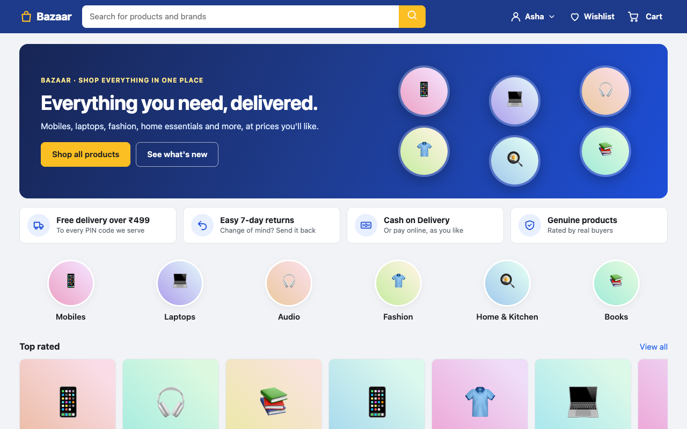
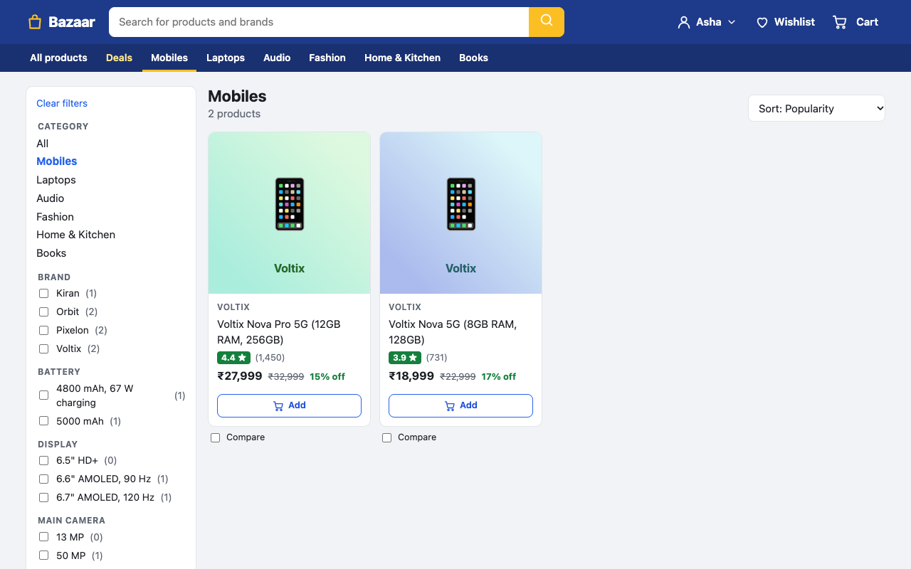
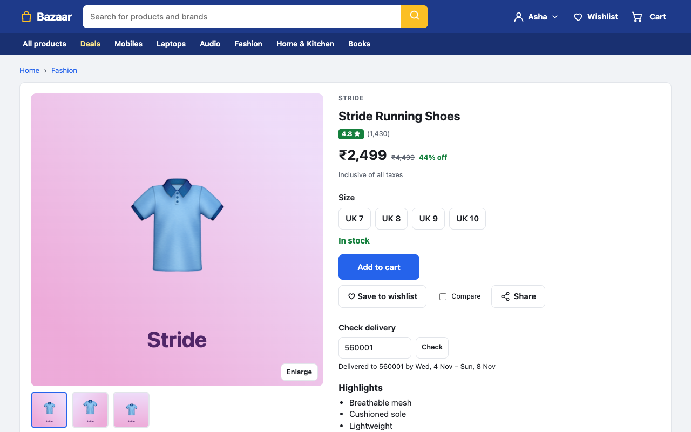
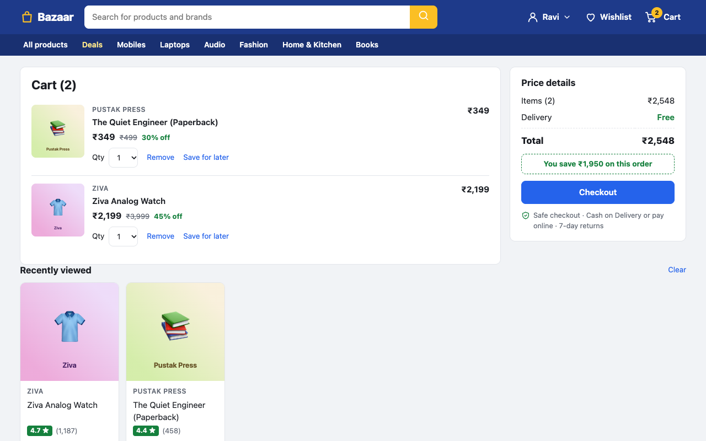
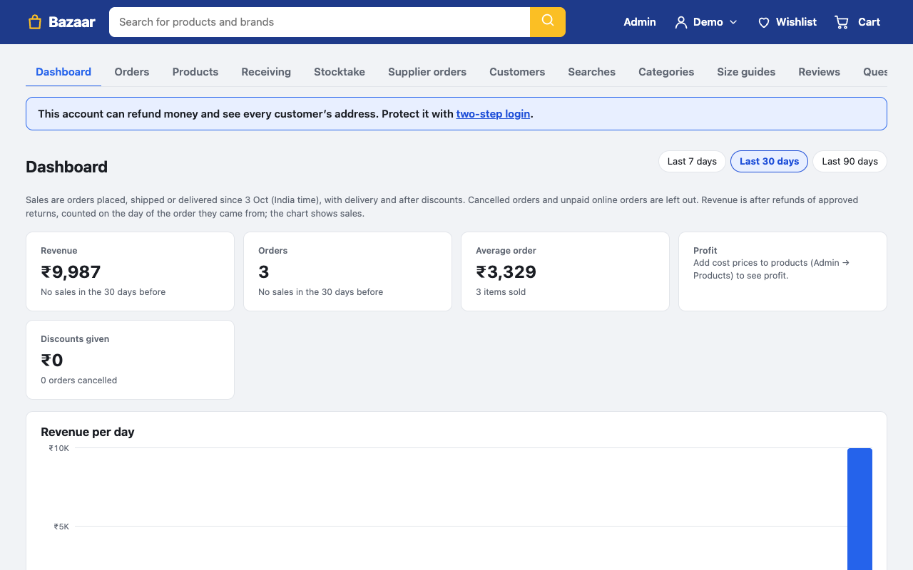
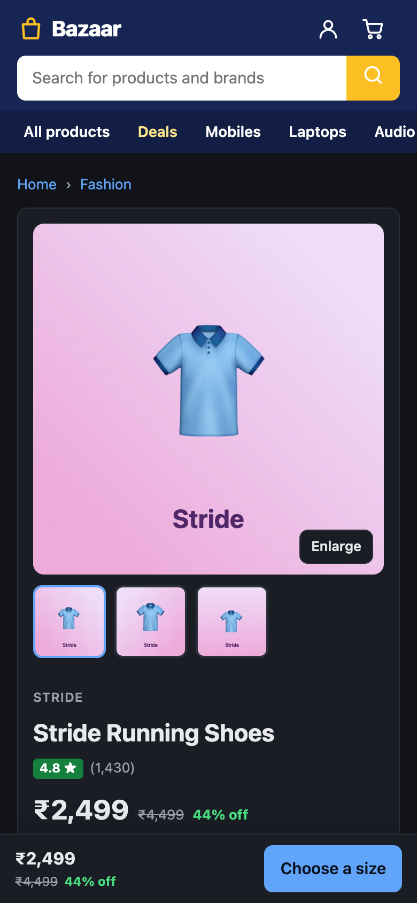
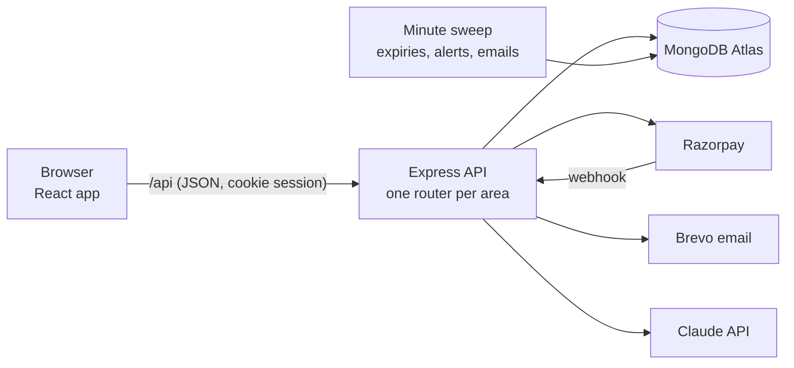

# Bazaar

[](https://github.com/nikhil832/shop/actions/workflows/ci.yml)

A full-stack online store in the style of India's big marketplaces, built with **React, Express and MongoDB**: catalog and
search, cart and checkout with **Razorpay** payments, GST invoices, returns, a complete admin back office, emails, and
features powered by the **Claude API**.

**Live:** https://bazaar-jup1.onrender.com (free hosting: the first visit can take about 30 seconds to wake the server;
payments are in Razorpay's test mode, so no real money moves)

| Home                                    | Search with filters                                      | Product page                                                        |
| --------------------------------------- | -------------------------------------------------------- | ------------------------------------------------------------------- |
|  |               |                        |
| **Cart**                                | **Admin dashboard**                                      | **Phone, dark theme**                                               |
|       |  |  |

## Highlights

**Shopping**

- Search ranked by relevance, with synonyms, plurals, "did you mean" spelling fixes and live suggestions; filters by
  brand, price, rating, size and product specifications (RAM, storage, …), all kept in the URL.
- Product variants (sizes and colours with their own stock and photos), size guides, size fit from reviews, compare up
  to three products, recently viewed, "bought together" and similar-product rows.
- Reviews with photos and helpful votes, customer questions and answers, wishlist with price-drop and price-target
  alerts, back-in-stock emails, and saved searches that email new arrivals.

**Checkout and orders**

- Cart quoted by the server (prices and stock re-read, never trusted from the browser); coupons, bundles, quantity
  discounts, gift cards, store credit, cashback and loyalty levels.
- **Razorpay** online payments (verified on the server by signature and API, with a webhook as backup, refunds on
  cancellation) next to Cash on Delivery; stock held for 30 minutes while paying.
- Orders placed in **MongoDB multi-document transactions**, so stock, coupons and credit change together or not at all.
- GST tax invoices and credit notes (CGST/SGST or IGST by place of supply), delivery areas and dates by PIN code,
  tracking, returns, exchanges and cancelling part of an order.
- Order, password-reset and marketing emails through **Brevo**, with one-click unsubscribe.

**Admin back office**

- Sales dashboard (revenue, profit, repeat customers, sales by state), orders with packing slips and shipping labels,
  products with photo uploads, CSV import/export, stock history, stocktakes and supplier orders.
- Staff roles with permissions (admin, packer, support), an activity log of every change, scheduled sales,
  collections, announcements, a help inbox and store news emails to chosen customer groups.

**AI features (Claude API)**

- A shopping assistant that searches the live catalog through tool use, product descriptions and photo descriptions
  drafted for admins, answer drafts for customer questions, "what customers say" summaries of reviews, screening of
  new reviews and questions, plain-words search, and plain-English explanations of error reports.

**Security and accessibility**

- scrypt password hashing, login limits per account and per network, TOTP two-step login with recovery codes, hashed
  one-time tokens, rate limits, a strict Content-Security-Policy and other security headers, CSV formula-injection
  guards.
- Checked against WCAG 2.1 AA with axe on every page, in light and dark themes; works by keyboard and on phones.

The full list, stage by stage (143 of them), is in [docs/FEATURES.md](docs/FEATURES.md).

## Tech stack

| Area     | Tools                                                                                                    |
| -------- | -------------------------------------------------------------------------------------------------------- |
| Frontend | React 19, React Router 8, Vite 7, plain CSS with light and dark themes                                   |
| Backend  | Node.js 22+, Express 5, zod validation, MongoDB driver 7                                                 |
| Database | MongoDB Atlas (replica set, for transactions)                                                            |
| Services | Razorpay (payments, test mode), Brevo (email), Anthropic Claude API (AI features)                        |
| Testing  | node:test with an in-memory MongoDB replica set, Playwright browser tests, axe-core accessibility checks |
| Tooling  | ESLint, Prettier, GitHub Actions CI, Render (hosting, deploys every push to `main`)                      |

## How it fits together



- **Money is integer paise** everywhere (database, API, browser), formatted only for display.
- **Every input is validated** with zod schemas; handlers throw typed HTTP errors.
- **Stock checks live in the database update** (`stock >= qty` in the filter), so two buyers can't buy the last item.
- **Payments are idempotent**: the browser, a "check again" button and the webhook can all confirm a payment, and it
  counts once.
- **The URL is the state** for search, filters, sort and page, so every result can be shared or bookmarked.

## Quality

- **600+ API tests** (node:test), each file against a fresh in-memory MongoDB replica set seeded with the sample
  catalog, so tests never touch real data.
- **170+ browser tests** (Playwright with Chrome), including payments through a Razorpay stand-in and accessibility
  checks on every page.
- **CI on every push** (GitHub Actions): lint, format check, API tests, build, browser tests.

## Run it locally

Needs Node.js 22.12 or newer. No database or accounts needed for the demo:

```bash
npm install
npm run demo     # in-memory MongoDB with sample products; open http://localhost:5173
```

The demo also creates an admin account, `admin@bazaar.demo` / `demo-admin-123`, for the admin panel at `/admin`.

Running against MongoDB Atlas, the optional services (Razorpay, Brevo, Claude) and deploying are covered in
[docs/SETUP.md](docs/SETUP.md); every API route is in [docs/API.md](docs/API.md), and ideas not built yet in
[ROADMAP.md](ROADMAP.md).

## Author

Nikhil Bansal · [GitHub](https://github.com/nikhil832)
